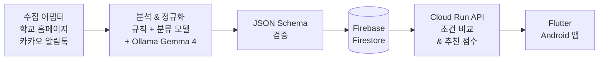

# 🤫 귀띔 (Gwittim)

> **명지전문대 학생을 위한 맞춤형 교내외 공고 추천 및 조건 분석 Android 앱**

귀띔은 학교 홈페이지와 카카오톡 알림톡에 산재된 공지사항을 한곳에 모아 분석하여, 학생 개인의 학적·관심사에 딱 맞는 장학·비교과·채용·공모전 공고를 콕 집어 추천해 주는 서비스입니다.

---

## 📌 주요 기능

* **홈 & 하루 첫 브리핑:** 마감 임박 공고, 신규 공고, 학과 통계 기반 추천 및 마감 변경 소식 제공
* **공고 탭:** 검색 및 분류 칩으로 전체 공고 탐색
* **공고 분석 리포트:**
  * 지원 자격 자동 판단 (**충족** / **미충족** / **확인 필요**)
  * 핵심 내용 한 줄 요약, 주요 일정 및 원문·신청 사이트 바로가기
* **맞춤 프로필:** 학적·관심사·희망 직무 기반 추천 (학과별 졸업생 진로 데이터 연동)
* **달력 & 저장함:** 관심 공고 스크랩 및 마감 일정 시각화
* **계정 & UX:** Google 로그인 지원, 라이트/다크 테마 제공

> 💡 **데이터 정확성 원칙**  
> 불확실한 마감 시각은 임의 확정하지 않으며(`null`), 조건 미확인 시 '제한 없음'이 아닌 '**확인 필요**'로 명시하여 잘못된 정보 전달을 방지합니다.

---

## 🚀 현재 개발 및 검증 현황 (2026-11-07 기준)

* **체험판 배포:** Android 릴리스 APK 0.9.0 배포 (타 계정·기기 설치 및 가입, 추천 동작 검증 완료)
* **dev 환경 (`gwittim-dev`):**
  * 게시판 수집 배치 일 2회 자동 실행
  * 알림톡 공고 수동 반영
  * Cloud Run API 운영 중
* **실기기 검증:** Galaxy S25 Ultra release 빌드 기준 화면 전환 및 렌더링 프레임 측정 완료
* **테스트 현황:**
  * **Backend:** `pytest` 207개 통과 (3개 skip)
  * **App:** `flutter test` 157개 통과 (2개 skip)
* **기록 문서:** 명세 [SPEC.md](SPEC.md), 결정 사항 [docs/decisions.md](docs/decisions.md), 진행 상황 [docs/handoff.md](docs/handoff.md)

---

## 🏗️ 시스템 아키텍처 & 데이터 파이프라인



* **수집:** 명지전문대 홈페이지 게시판(`mjc_www`), 카카오톡 알림톡(`mjc_kakao`, 공통 공지)
* **분석:** 규칙 기반 추출 + 로컬 LLM(Ollama Gemma 4). 알림톡은 분류 모델이 먼저 처리하고 예외 건만 LLM에 전달
* **검증·게시:** JSON Schema(`contracts/`) 검증을 통과한 데이터만 Firestore에 게시
* **추천:** 지원 자격 비교, 관심사·직무·학과 통계 점수를 서버에서 계산 (앱은 결과만 표시)

---

## 🛠️ 기술 스택

* **App:** Flutter 3.47.7 / Dart (Android)
* **Backend API:** Python 3.12 (FastAPI), Google Cloud Run (`asia-northeast3`)
* **Batch / Pipeline:** Python + uv (일 2회 배치 실행), Ollama Gemma 4
* **Database / Auth:** Firebase Authentication, Firestore

---

## 💻 실행 방법

**앱 (합성 샘플 모드, 서버·로그인 없이 실행)**

```bash
cd apps/mobile
flutter pub get
flutter run
```

**백엔드 테스트 및 로컬 API**

```bash
uv sync
uv run pytest
uv run uvicorn backend.api.local:app --port 8765
```

> 서버 모드 및 Google 로그인 실행 방법은 [apps/mobile/README.md](apps/mobile/README.md)를 참고하세요.

---

## 📂 저장소 구조

```text
apps/mobile/             Flutter 앱
backend/collectors/      수집 어댑터 (mjc_www, mjc_kakao)
backend/analysis/        정규화·규칙·LLM 추출·검증
backend/classifier/      알림톡 꼬리표 분류 모델 (표준 라이브러리 계산)
backend/recommendation/  조건 비교·추천
backend/publish/         Firestore 게시
backend/api/             서버 API
contracts/               JSON Schema, 공통 사전, 학과 통계
fixtures/                합성 샘플 데이터
localModel/              분류 모델 학습 코드 (원본 자료 제외)
tools/                   계약 검증, 샘플·통계 생성
tests/firestore-rules/   Firestore 보안 규칙 테스트
docs/                    결정 기록, 인수인계, 화면 규칙(ui-style.md)
```

---

## 🔒 개인정보 & 비밀정보

* **개인 알림 미게시:** 카카오톡 원본 및 개인 알림(수강 과목·이름·학번 포함)은 게시·커밋하지 않습니다. 샘플 공고는 모두 `[합성 샘플]`입니다.
* **최소 수집:** 앱은 성적·학번을 묻지 않으며, 사용자 ID를 서버로 보내지 않습니다 (서버가 Firebase ID 토큰으로 확인).
* **비밀정보 미커밋:** API 키, 서비스 계정 JSON, `google-services.json`, 서명 키는 커밋하지 않습니다. 환경변수 이름과 설명은 [.env.example](.env.example)에만 기록합니다.

---

## 🤝 협업

* 2인 팀, 팀장이 의사결정 및 병합 담당
* `main` 직접 푸시 금지, 기능 브랜치 + PR 방식
* 사람·AI 코딩 에이전트 공통 작업 규칙: [AGENTS.md](AGENTS.md)
